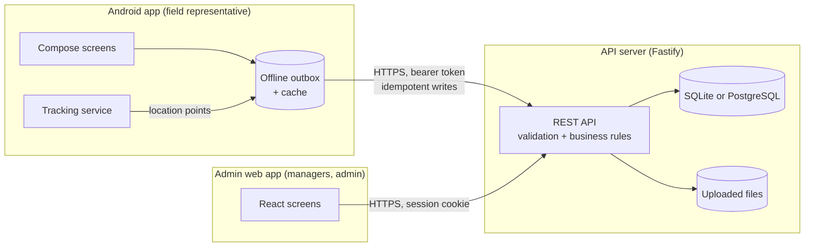
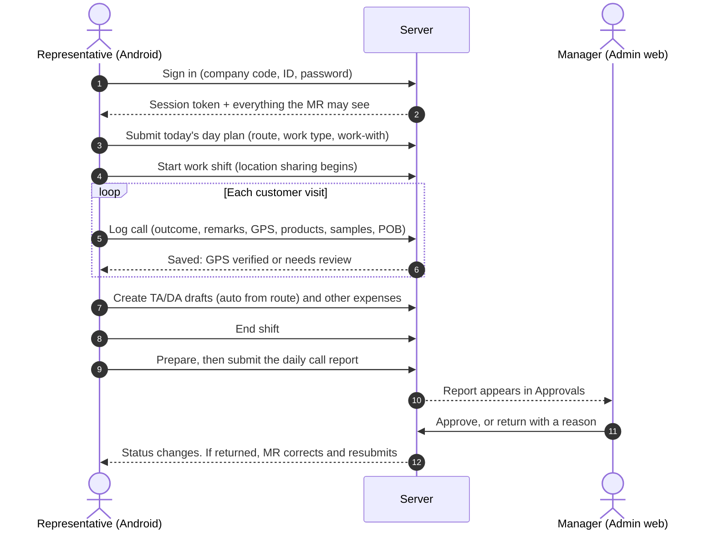
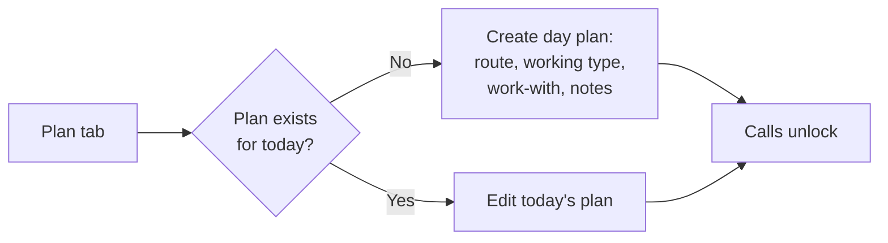
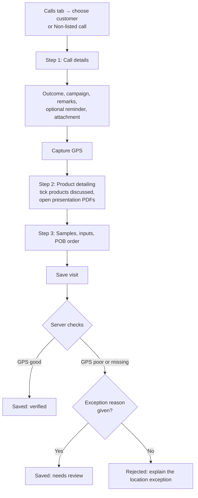
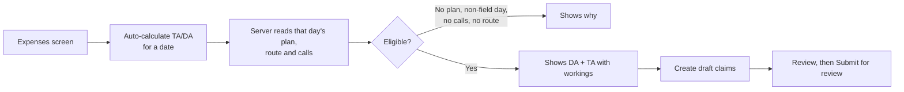
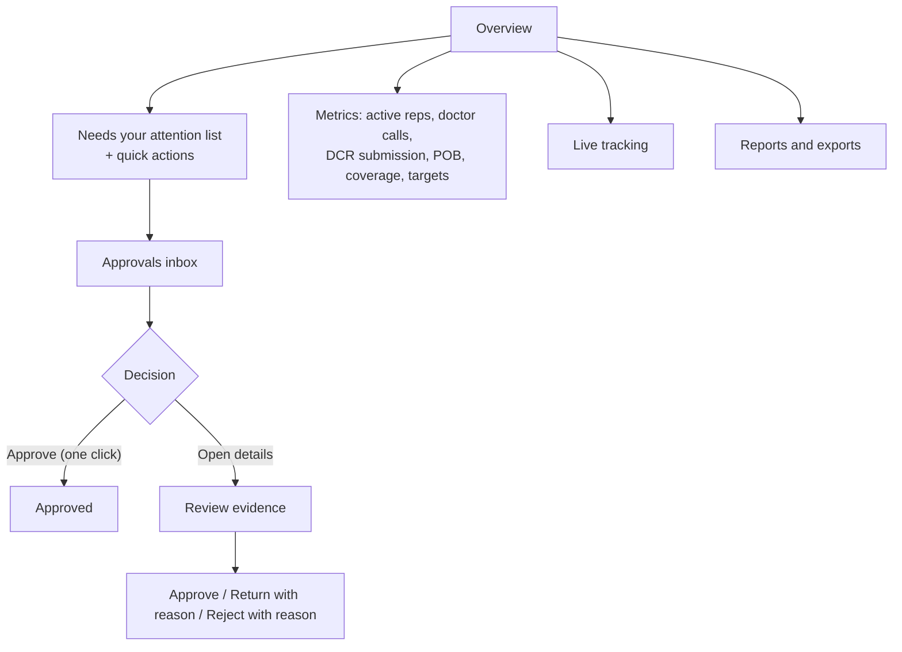
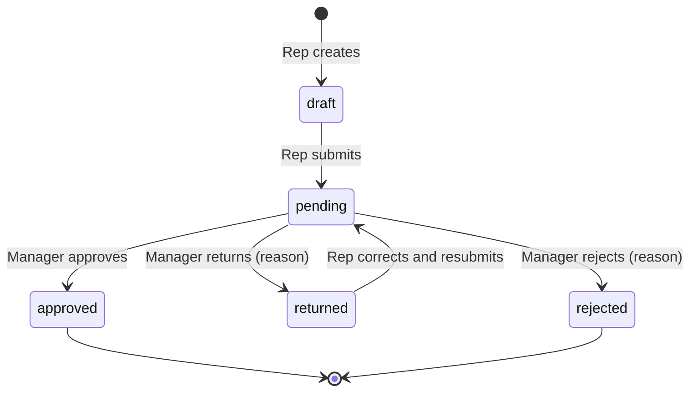
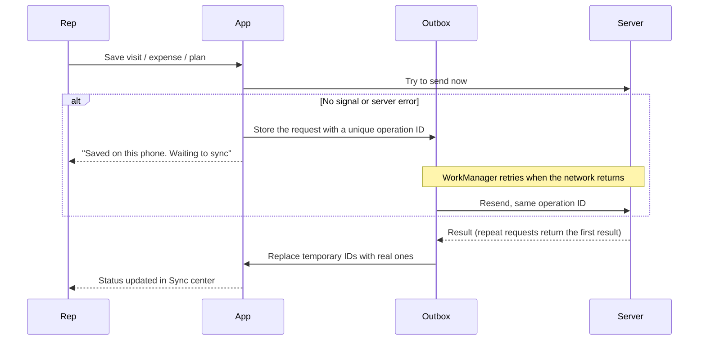
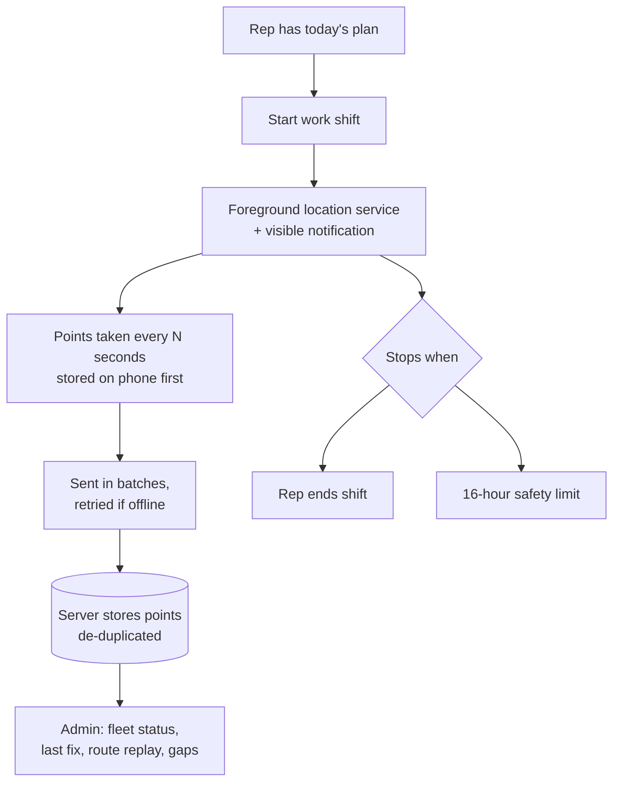

# MR Connect: how the whole system works

How the Android field app, the web admin and the server work together, from a representative's first sign-in to a manager's approval and the reports that come out of it.

- [1. The system at a glance](#1-the-system-at-a-glance)
- [2. Roles and who sees what](#2-roles-and-who-sees-what)
- [3. A representative's day, end to end](#3-a-representatives-day-end-to-end)
- [4. Android app flows](#4-android-app-flows)
- [5. Admin web app flows](#5-admin-web-app-flows)
- [6. The approval lifecycle](#6-the-approval-lifecycle)
- [7. Offline and sync](#7-offline-and-sync)
- [8. Location tracking](#8-location-tracking)
- [9. Business rules in one place](#9-business-rules-in-one-place)
- [10. Module and report map](#10-module-and-report-map)
- [11. What is not built](#11-what-is-not-built)

---

## 1. The system at a glance

Three parts share one database and one set of rules.

| Part                 | Who uses it                      | What it is for                                                                                                                  |
| -------------------- | -------------------------------- | ------------------------------------------------------------------------------------------------------------------------------- |
| **Android app**      | Field representatives (MRs)      | Plan the day, log calls with GPS evidence, record samples and orders, claim expenses, report, and share location during a shift |
| **Admin web app**    | Managers and company admin       | Set up masters, review and approve work, watch the team, read reports, change company policy                                    |
| **API server**       | Both apps                        | The single source of truth. Every rule is enforced here, so neither app can bypass it                                           |
| **Shared catalogue** | Server, admin, Android (via API) | `packages/shared` defines every module's fields once, so a new field appears in all three places                                |

Key idea: **the apps are thin.** A phone or browser asks; the server checks identity, team scope and business rules, then stores. The Android app additionally keeps a local copy so work continues without signal.

---

## 2. Roles and who sees what

| Role                     | Sees                                          | Can do                                                                                                                                            |
| ------------------------ | --------------------------------------------- | ------------------------------------------------------------------------------------------------------------------------------------------------- |
| **Representative (rep)** | Only their own records and assigned customers | Create own plans, calls, expenses, leave, reports. Submit for approval. Cannot approve anything                                                   |
| **Manager**              | Themselves plus everyone below them           | Everything a rep can see for their team, approve / return / reject submissions, set targets, preview TA/DA for the team. Cannot approve their own |
| **Admin**                | Everyone in the company                       | All of the above plus employees, territories, routes, products, policies, role permissions, audit log                                             |

How "below them" works: each employee has a `manager`; a manager's scope is the whole reporting tree under them (found recursively on the server). Every list, report and export is filtered through that scope, and a person in another company is never visible (every row is tagged with a company).

Admins can also change per-role Read / Write access for each module (Settings, Permissions).

---

## 3. A representative's day, end to end

Everything the MR does works offline too (section 7); the diagram shows the order once the phone has signal.

---

## 4. Android app flows

### 4.1 Sign-in and lock

1. **Welcome → Sign in.** Company code, employee ID or email, password, and the company server address.
2. The server returns a session token (valid 12 hours). The app stores it encrypted (Android Keystore) and downloads the MR's workspace: customers, routes, products, plans, recent visits, stock, policies.
3. Optional **6-digit PIN.** When the app goes to the background it locks; the PIN (with an attempt limit) unlocks it without signing in again.
4. If the session expires the app asks for sign-in again and keeps any saved work.

Sign-in is rate limited (10 attempts per 15 minutes). Changing company server clears the PIN, and a shift must be ended first.

### 4.2 Navigation

Bottom bar: **Today · Calls · Plan · Reports · More.** "More" is grouped like the admin sidebar:

| Group            | Items                                                                             |
| ---------------- | --------------------------------------------------------------------------------- |
| Today            | Daily call reports, Pending reporting dates, My performance                       |
| Planning         | Plan the month, Tour plans, Day plans, Targets, Campaigns, Leave                  |
| People & masters | Routes, Head quarters, Products, Promotional inputs                               |
| Money & stock    | Expenses, Sales activity, Stock statements, Stock balances, Challans, Sponsorship |
| Field records    | RCPA, Call reminders, Head-office updates                                         |
| Account          | Sync center, Account & settings, My access, Help & support                        |

Items for modules the role cannot read are hidden.

### 4.3 Day plan

A day plan is required before logging calls or starting a shift. Past plans are locked.

### 4.4 Logging a call

What the server does when a call is saved:

- Confirms the customer is assigned to this rep, and the day plan is theirs and matches the call date.
- **GPS verification** passes only if the fix is not a mock location, accuracy is within the company limit, it was taken within 2 minutes of the call, and it is within the verification radius of the customer's saved location. Otherwise a written reason is required and the call is flagged **needs review**.
- **Non-listed call** (someone not in the customer list): verified on accuracy, freshness and mock flag only, since there is no saved location to compare.
- Prices the POB order from the product master (the phone cannot set prices).
- Deducts sample and input stock in the same transaction; it refuses if stock is insufficient.
- A linked **reminder** is marked complete.
- Stores class, area and work-with with the visit so reports stay accurate later.

Call types: doctor, chemist, hospital, stockist, dietitian, non-listed, and reminder calls.

### 4.5 Expenses and auto TA/DA

- **DA** = company rate for the route's type (local, ex-station, outstation) plus any extra route allowance.
- **TA** = route master distance × TA per km. If the route is marked **One way**, the distance is doubled so the return journey is paid.
- Only categories not already claimed (and not rejected) are created. Auto TA/DA is exempt from the receipt rule; hand-made claims at or above the threshold need a receipt, and a client cannot fake the exemption.
- GPS distance is evidence only; it is never used to pay.

Other claims (hotel, meals, other) are entered by hand with remarks and an optional receipt photo or PDF.

### 4.6 Tour plan for the month

`More → Plan the month`

1. Pick the month (this or next), a default working type and route.
2. Weekly offs (set in company policy) are filled in automatically.
3. Tap "apply to every open working day", then adjust any day: working type, route, and a work-with person for joint work.
4. **Save draft** or **Submit month**. Submitting needs every working day filled in and sends all days for approval together. Submitted or approved days are locked.

### 4.7 Other rep flows

| Flow                         | How it works                                                                                                                                                                            |
| ---------------------------- | --------------------------------------------------------------------------------------------------------------------------------------------------------------------------------------- |
| **Leave**                    | Date range and reason. The server blocks overlap with another request. Goes to the manager                                                                                              |
| **RCPA**                     | Chemist, prescribing doctor, our product, rate and units, competitor brand/rate/units and extra competitor lines, potential, objective, action                                          |
| **Stock & sales statement**  | One per month: opening, receipts and sales per product; closing is calculated. Zero-sale option, attachment, submit. **Move sales to next month** carries sales into next month's draft |
| **Challan**                  | Admin dispatches stock; the rep confirms the quantity received (explaining any difference), and only then does stock increase                                                           |
| **Secondary / doctor sales** | Simple sales entries with product, units and value                                                                                                                                      |
| **Sponsorship**              | Request for a doctor and campaign with amount and purpose; goes to the manager                                                                                                          |
| **Targets**                  | Read-only for reps; the "My performance" screen shows progress against the month's targets                                                                                              |
| **Daily call report**        | Pick the date, review calls and expenses, add remarks, prepare, then submit from its detail screen. A submitted report locks that day's activity                                        |
| **Pending reporting dates**  | Lists past days that still need a report, and warns when the reporting window has passed                                                                                                |

---

## 5. Admin web app flows

Sign-in uses the same company code and credentials and keeps a secure browser session cookie.

### 5.1 Navigation

| Group            | Pages                                                                                    |
| ---------------- | ---------------------------------------------------------------------------------------- |
| Today            | Overview, Approvals (with live count), Calls & tracking, Calls & daily reports           |
| Planning         | Tour plans, Tour calendar, Day plans, Targets, Campaigns, Leave                          |
| People & masters | Field team, Customers, Routes & territories                                              |
| Money & stock    | Expenses, TA/DA calculator, POB & sales, Stock statements, Samples & inputs, Sponsorship |
| Field records    | RCPA, Reminders, Head-office updates                                                     |
| Insights         | Reports                                                                                  |
| Bottom           | Settings, account, sign out                                                              |

A breadcrumb in the top bar shows where you are. Pages a role cannot use do not appear.

### 5.2 The manager's daily loop

- **Overview:** attention list first, then date and rep filters, key numbers, coverage, POB trend and target progress.
- **Approvals inbox:** daily reports, expenses, leave, tour days and sponsorship, filtered by team. A manager can never approve their own submission. Return and reject require a written reason.
- **Visit exceptions:** calls saved without passing GPS checks. The manager sees the evidence (distance, accuracy, timing) and accepts or flags each one.
- **Call evidence page:** map position against the customer, and every GPS check with pass or fail.

### 5.3 Planning and money

| Page                 | What it does                                                                                                      |
| -------------------- | ----------------------------------------------------------------------------------------------------------------- |
| **Tour calendar**    | Month grid per representative: weekly offs, route, work type, work-with and approval status, with counts          |
| **TA/DA calculator** | Preview what policy pays for any team member and date, with the workings. You can create drafts only for yourself |
| **Targets**          | Set monthly doctor-call, chemist-call, POB and sales targets per rep (one per person per month)                   |
| **Stock statements** | Review monthly statements, including moved-in sales and closing stock                                             |
| **Expenses**         | Review claims, receipts, and auto-calculated markings                                                             |

### 5.4 Masters and setup (admin)

- **Field team:** employees, reporting manager, head quarter, role; reset access.
- **Customers:** one directory for doctors, chemists, hospitals, stockists and dietitians. Add, edit, import from CSV (all-or-nothing with row-level errors), extra addresses.
- **Routes & territories:** route name, origin, via points, distance, DA type, **master distance covers (round trip or one way)**, extra allowance.
- **Products & inputs:** products with price and presentation PDF; promotional inputs.
- **Campaigns:** dates, products and participating customers.
- **Samples & inputs:** stock balances by person; challans dispatch stock to reps.
- **Settings:** company policies (grouped), roles and per-module permissions, integration status, audit log, support requests, own account.

### 5.5 Policies that drive behaviour

| Group                 | Settings                                                                    |
| --------------------- | --------------------------------------------------------------------------- |
| Visit verification    | Verification radius, maximum GPS uncertainty                                |
| Reporting             | Reporting window (days), missing-update threshold, weekly off day           |
| Allowances & expenses | Local, ex-station, outstation DA; TA per km; receipt required from (amount) |
| Location tracking     | Tracking interval, retention period                                         |

Changes apply to new submissions and new tracking sessions, and are written to the audit log.

---

## 6. The approval lifecycle

- **Which records go through approval:** daily reports, expenses, leave, tour days, sponsorship, and stock statements.
- **Locks:** a pending or approved daily report locks calls, expenses, sales and RCPA for that date. A manager must return the report to unlock it.
- **No self-approval,** and a manager only sees submissions from their own tree.
- **Concurrency:** every record carries a version. If two people edit at once, the second save is stopped with a "changed on another device" message, and the phone shows what differs so nothing is lost silently.
- **Audit:** creation, submission, decisions, exports, policy changes and sign-ins are written to an audit trail the admin can read.

---

## 7. Offline and sync

Field work happens without signal, so the Android app is built to keep working.

- **Operation IDs make retries safe.** If the server received a request but the reply was lost, resending returns the original result: no double visit, no double stock deduction.
- **Dependencies:** a visit that references an attachment still being uploaded waits until the real attachment ID exists, then the ID is swapped in automatically.
- **Sync center** lists everything waiting, lets the rep review, retry or discard an item, and shows conflicts.
- **Server-side checks still apply on sync.** A queued visit that breaks a rule (for example, the reporting window passed) is reported back; it is not silently accepted.
- Cached screens (workspace, performance) are shown when offline, with an "Offline" banner.

---

## 8. Location tracking

Tracking is **explicit and visible**: it only runs during a work shift the rep starts, with a notification showing.

- Each point keeps the **observed time** (when taken) and **received time** (when the server got it), plus accuracy and a mock-location flag.
- Poor or mocked points are kept as evidence but excluded from distance.
- Gaps (phone off, permission revoked, signal lost) are recorded as **observed gaps**; the system never invents points to hide them.
- Admin **Calls & tracking** shows fleet status, last fix and accuracy, a time-ordered route replay on a map, device events, and the recorded distance.
- Ordinary Android "Force Stop" can stop the service. Fully managed company phones are the intended fleet; physical-device acceptance is still listed as pending in `TESTING.md`.

---

## 9. Business rules in one place

| Area               | Rule                                                                                                                            |
| ------------------ | ------------------------------------------------------------------------------------------------------------------------------- |
| Call GPS           | Real (not mock), accurate enough, fresh (≤ 2 min from the call), within radius of the customer; otherwise reason required       |
| Call window        | Not in the future; within the reporting window; not on a locked (submitted) day                                                 |
| Stock              | Samples and inputs deduct per call and never go negative; challan adds stock only when the rep acknowledges receipt             |
| POB pricing        | Always priced by the server from the product master                                                                             |
| TA/DA              | Policy rates; TA = distance × per-km rate (one-way routes double the distance); GPS distance is evidence only                   |
| Receipts           | Required from the configured amount, except auto-calculated TA/DA                                                               |
| Leave              | No overlapping requests for a person                                                                                            |
| Tour plan          | Month cannot be in the past; weekly off auto-filled; whole month submitted together; submitted days locked                      |
| Stock statement    | One per person per month; closing = opening + receipts − sales; never negative; zero-sale cannot contain sales                  |
| Targets            | One per person per month; only managers set them; at least one target value                                                     |
| Approvals          | Manager only, never own submission, reason required for return and reject                                                       |
| Passwords/sessions | Rate-limited sign-in; sessions expire after 12 hours; password change revokes other sessions                                    |
| Imports/exports    | Customer CSV import is all-or-nothing; exports are written to the audit log and protected against spreadsheet formula injection |

---

## 10. Module and report map

### Modules (records both apps can read or write)

| Module             | Rep writes | Needs approval | Visible in admin as              |
| ------------------ | :--------: | :------------: | -------------------------------- |
| Territory / HQ     | Admin only |       No       | Routes & territories             |
| Customer           |    Yes     |       No       | Customers                        |
| Route              |    Yes     |       No       | Routes & territories             |
| Product, Input     | Read-only  |       No       | Samples & inputs / products      |
| Campaign           | Read-only  |       No       | Campaigns                        |
| Day plan           |    Yes     |       No       | Day plans                        |
| Tour plan          |    Yes     |      Yes       | Tour plans, Tour calendar        |
| Expense            |    Yes     |      Yes       | Expenses                         |
| Leave              |    Yes     |      Yes       | Leave                            |
| Sponsorship        |    Yes     |      Yes       | Sponsorship                      |
| Stock statement    |    Yes     |      Yes       | Stock statements                 |
| Target             | Read-only  |       No       | Targets                          |
| Sale               |    Yes     |       No       | POB & sales                      |
| Challan            | Read-only  |       No       | Samples & inputs                 |
| Reminder, RCPA     |    Yes     |       No       | Reminders, RCPA                  |
| Head-office update | Read-only  |       No       | Head-office updates              |
| Visit (call)       |  Via call  |  Review only   | Calls, evidence, exceptions      |
| Daily call report  |    Yes     |      Yes       | Approvals, Calls & daily reports |

### Reports (Reports page, all exportable to CSV)

Productivity · Deviations (tour vs actual) · Missed coverage · Product reach · Expenses · POB · Sales · **RCPA analysis** (market share, gap to objective) · **Call average** (working days, coverage %, missed doctors, call averages) · **Doctor class** (A+/A VIP flag, frequency compliance) · **Target vs achievement** · **Sample & gift balance** · **Sample & gift distribution** · Inventory · Audit (admin only).

Every report respects the viewer's team scope and the date range chosen.

---

## 11. What is not built

These are in the original presentation but not in the product yet, or are deliberate boundaries:

- Dynamic report builder with saved formats; circular, banner and promotion/demotion masters.
- IMEI device registration reset; scheme and special-rate requests; Sunday-working and DCR-edit flows; separate route-link screens; manager "ready reckoner".
- Email, SMS, ERP and remote push are shown as **not configured**; nothing is faked.
- Finance, payroll, manufacturing and e-commerce are outside this SFA scope.
- The server is designed for a single instance; production hosting, HTTPS domain, store signing and physical-handset acceptance tests remain release steps.

See also: [API.md](API.md), [COVERAGE.md](COVERAGE.md), [TESTING.md](TESTING.md), [DEPLOYMENT.md](DEPLOYMENT.md), [IMPLEMENTATION.md](IMPLEMENTATION.md).
