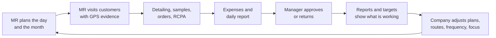
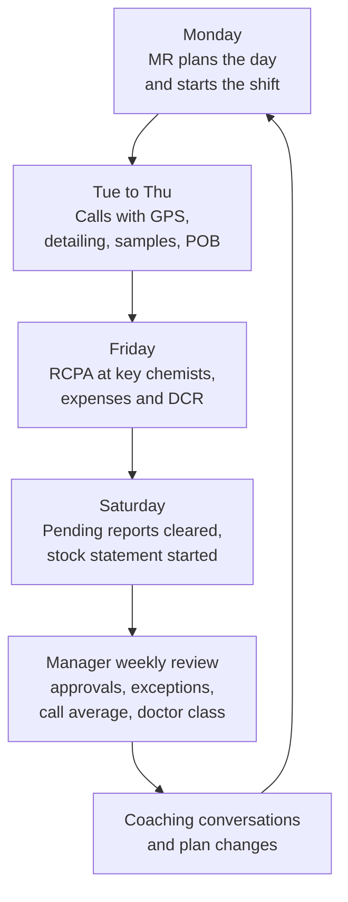
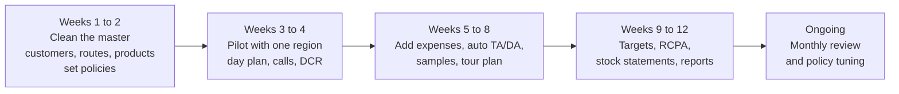

# MR Connect: the practical feature guide

**How each feature helps a Medical Representative, how a pharmaceutical company can use it, and whether it is the right way to do it.**

Written for: medical representatives (MRs), first-line managers, and sales-operations and compliance leaders at a pharmaceutical company who are deciding how to roll MR Connect out and use it well.

## How to read this guide

Every feature follows the same pattern, so you can jump straight to what you need:

> **MR: use it well.** Practical steps, habits and mistakes to avoid, from the field.

> **Company: use it and benefit.** How sales managers, sales operations and leadership put the data to work, and what to measure.

> **Use case.** A realistic example with numbers (all names and figures are invented for illustration).

> **Is it right?** An honest verdict: why the design is sound, where it has limits, and what to do about those limits.

Numbers in examples use the **default company policy** unless stated: GPS radius 200 m, maximum GPS uncertainty 100 m, reporting window 7 days, receipt needed from ₹500, DA ₹250 local / ₹400 ex-station / ₹650 outstation, TA ₹3.5 per km, location point every 60 seconds, location kept for 180 days. Your company sets its own values in Settings.

**Short glossary.** **MR**: medical representative. **HCP**: healthcare professional (doctor, dietitian). **HQ**: head quarter, the MR's base town. **DCR**: daily call report. **POB**: personal order booked (an order the MR books from a chemist or stockist). **RCPA**: retail chemist prescription audit (checking which brands a chemist actually dispenses on a doctor's prescriptions). **TA/DA**: travel allowance / daily allowance. **Detailing**: presenting a product to a doctor. **Master**: the company's approved list (customers, routes, products).

## The big picture: why these pieces fit together

The value is the **loop**. Planning sets the promise, calls and GPS evidence show what really happened, approvals keep the record honest, and reports turn the record into decisions. A single feature helps. The connected loop is what changes how a sales force is managed.

| Part of the loop    | Features                                                                          | Main question it answers                  |
| ------------------- | --------------------------------------------------------------------------------- | ----------------------------------------- |
| **Plan**            | Customer master and classes, day plan, tour plan, targets                         | Who should we meet, how often, and where? |
| **Do**              | Calls, non-listed and reminder calls, detailing, samples, orders, RCPA, campaigns | What happened in front of the customer?   |
| **Prove**           | GPS verification, shift tracking, daily report, approvals                         | Can we trust the record?                  |
| **Pay and account** | Expenses and auto TA/DA, leave, sponsorship, stock statement, sales               | What did it cost, and what stock moved?   |
| **Learn**           | Overview, reports, exceptions, audit                                              | What should we change next month?         |

---

# Part A. Foundations

## 1. Sign-in, PIN lock and working offline

**What it does.** The MR signs in with company code, employee ID and password. The app can be locked with a 6-digit PIN, and it keeps working without signal by saving work on the phone and sending it later.

> **MR: use it well.**
>
> - Set the PIN on day one (Account and settings). A lost or borrowed phone then cannot be used to file calls in your name.
> - Open the app and let it sync once while you still have signal (office, hotel, home). It downloads your customers, routes and products so you have them in the clinic basement.
> - Check the **Sync center** at the end of every day. If anything says "waiting", connect to Wi-Fi before you leave for home.
> - Mistake to avoid: signing out in the middle of the day with unsent work. Saved work is kept, but it is easier to finish syncing first.

> **Company: use it and benefit.**
>
> - Field work in many towns has weak coverage. Offline support means MRs do not postpone entries "until tonight", which is when records become inaccurate.
> - The PIN and encrypted session give you a basic security answer for personal or shared phones during audits.
> - Measure: share of calls that were saved offline and synced later (Sync center on the phone, audit trail on the server), and the average delay between visit time and sync time.

> **Use case.** Meera works a hill route with no signal after 11 a.m. She logs five calls offline. At 6 p.m. her hotel Wi-Fi connects and the app sends all five. Each carries the original visit time, so her manager sees them at the right time of day, not "6 p.m. all five". A dropped connection during sync does not create duplicate calls, because each save carries a unique operation ID.

> **Is it right?** **Yes, with one caution.** Saving on the phone first and syncing later is the correct design for field work, and the duplicate-proof operation IDs are what make it safe. The caution: the server still applies every rule when the work arrives. A call that is too old (past the 7-day reporting window) will be refused on sync, so offline does not mean "unlimited time".

## 2. Customer master, classes and call frequency

**What it does.** One directory for doctors, chemists, hospitals, stockists and dietitians. Each customer has a **class** (A+, A, B, C), a **visits-per-month frequency**, an assigned MR, a route, an area and, ideally, a saved map location.

> **MR: use it well.**
>
> - Know your **A+ and A** doctors first. They carry the highest frequency, and your missed-call and compliance reports measure you on them.
> - If a doctor moves clinic, tell your manager so the master location can be corrected. A stale location is the most common reason a good call is marked "needs review".
> - Use **Customer addresses** to add a second clinic or hospital so the right place is verified.

> **Company: use it and benefit.**
>
> - **Segment once, manage everywhere.** Class and frequency drive three things: the planned workload per MR, the "missed doctors" report, and the doctor-class compliance report.
> - Import customers in bulk from CSV. The import is all-or-nothing and reports the exact bad row, so a half-loaded master never appears.
> - Keep master data clean as a standing task (owner: sales operations). Dirty masters create dirty reports.
> - Measure: share of customers with a map location, share with a class and frequency, duplicates found per quarter.

> **Use case.** A territory has 120 doctors: 15 A+ (4 visits/month), 35 A (3), 45 B (2), 25 C (1). Required calls per month = 15×4 + 35×3 + 45×2 + 25×1 = 60 + 105 + 90 + 25 = **280 doctor calls**. With 22 working days, that is about **12.7 doctor calls a day**. If the manager sees that this is unrealistic, the fix is to rebalance classes or split the territory, not to blame the MR.

> **Is it right?** **Yes.** Tiering customers by potential and giving each tier a visit frequency is standard sales-force practice, and the arithmetic above makes workload visible. The limit: the app records the class you give it. It does not decide the class. Review classes at least twice a year or the "compliance" numbers will measure yesterday's priorities.

## 3. The day plan

**What it does.** Each morning the MR submits a short plan: route, working type (field work, joint work, meeting, training, administration) and, for joint work, who they are working with.

> **MR: use it well.**
>
> - Submit the plan **before the first call**. Calls and the work shift stay locked until a day plan exists, on purpose.
> - Choose the route that matches where you will really go. Deviations between the approved tour plan and what you actually did show up in a deviation report, so a quick change is fine, but it should be honest.
> - For joint working with your manager, pick them under "work with". The call records will show who accompanied you.

> **Company: use it and benefit.**
>
> - The day plan is the "promise" the day is judged against. It lets managers see by 9:30 a.m. who has started, without calling anyone.
> - Pair it with the tour plan: the deviation report compares the approved tour with the day's route.
> - Measure: percentage of working days with a plan submitted before the first call; deviation rate.

> **Use case.** At 9:15 the manager opens Overview and sees "Active representatives 14 / 16". Two MRs have not planned. A quick message finds one on leave that was not entered and one with a phone problem. Without the day plan, the same discovery would happen at the end of the day.

> **Is it right?** **Yes.** A required plan before calls is a light-touch control that gives real-time visibility without surveillance. It is a start-of-day habit, not proof of work; proof comes from the call evidence in section 6.

## 4. The monthly tour plan and the tour calendar

**What it does.** The MR plans the whole month in one screen: for every working day, a working type, route and (for joint work) a partner. Weekly offs are filled in automatically from company policy. The month is submitted together and managers approve it. Managers (and admin) see it laid out on a **tour calendar**.

> **MR: use it well.**
>
> - Plan the next month during the last week of this month. Choose a route and working type once, tap "apply to every open working day", then adjust the exceptions (a conference, a joint-work day).
> - Fill every working day. The month cannot be submitted with gaps, which stops half-plans from reaching your manager.
> - Once a day is submitted or approved it is locked. If you need a change, ask your manager to return it.

> **Company: use it and benefit.**
>
> - The tour calendar answers "who is where this month" in one view, with approval status per day. Use it for joint-work planning, event coverage and leave cover.
> - Set the weekly off day in Settings once (default Sunday), and it is applied to everyone.
> - Measure: percentage of MRs with the next month approved before the 25th; number of days changed after approval.

> **Use case.** Rahul's manager opens the tour calendar on the 26th. Rahul has 18 days planned and 4 unplanned working days, shown with dashed cells. The manager sees Rahul has no joint-work day with her scheduled and drops one on the 12th. The plan is complete before the month begins.

> **Is it right?** **Yes, with a workload caveat.** Planning a month ahead and approving it is the standard way to control coverage. One honest limit: managers approve **day by day**, so a month of 22 days means 22 approvals per MR. The inbox has one-click Approve to keep that fast, but large teams should agree a weekly approval routine.

## 5. Work shift and location tracking

**What it does.** The MR starts a **work shift** after planning. While the shift runs, the phone records its location at intervals (default every 60 seconds), with a visible notification. Ending the shift stops tracking, and a 16-hour safety limit stops it automatically.

> **MR: use it well.**
>
> - Start the shift when you begin field work, end it when you finish. Tracking only exists inside that window.
> - Grant "precise location" and allow the app to run in the background, or the phone will put the app to sleep and leave gaps.
> - If the phone lost signal or battery, nothing is wrong. Gaps are recorded as gaps, not as misconduct. If a manager asks, you can explain a battery or signal gap.
> - Keep mock-location apps off. They are detected and flagged.

> **Company: use it and benefit.**
>
> - Use the map replay to **resolve disputes quickly** ("was she really in Sector 62?") and to support honest exceptions. Do not use it to micro-manage every minute.
> - Use recorded distance as **evidence beside the claim**, not as payment. Route and TA policy stay in the master.
> - Measure: shifts started per working day, share of shifts with long gaps, share of mock-location flags.
> - Governance: publish a short policy that says when tracking runs, what is stored, who can see it and how long it is kept (default 180 days).

> **Use case.** A manager sees a call logged at 11:40 flagged "needs review". The replay shows the MR within 600 m of the clinic at 11:35 and 11:45 (a large hospital campus). The manager accepts the call. Time spent: one minute instead of a phone call and a doubt.

> **Is it right?** **Yes, if handled openly.** Starting tracking by an explicit action, with a visible notification and a hard stop, is the respectful and defensible way to do it. Two cautions. First, tracking is only as good as phone settings: Android's force stop and aggressive battery savers can still cut it, which is why fully managed company phones are recommended. Second, location is personal data: obtain employee consent, limit access to those who need it, and have HR or legal review the policy under the data-protection law that applies to you.

---

# Part B. In the field

## 6. Calls with GPS verification

**What it does.** The MR logs a call to a doctor, chemist, hospital, stockist or dietitian in three steps: call details (outcome, remarks, campaign, GPS), product detailing, and samples and orders. The server checks the GPS evidence and marks the call **verified** or **needs review**.

> **MR: use it well.**
>
> - Tap **Capture GPS** while you are **at** the clinic, before saving. A fix taken in the car park or an hour earlier fails the freshness check (it must be within 2 minutes of the call).
> - Wait for accuracy of about 100 m or better. Indoors, step near a window or door and capture again.
> - If the location still fails, **explain the reason in one honest sentence** ("Doctor moved to new clinic, master location outdated"). A good reason becomes a quick accept; a vague or missing one blocks the save.
> - Write useful remarks: what you discussed, objections, the next step. They are the memory for your next visit.
> - Mistake to avoid: logging calls in the evening from memory. The call time is recorded, and calls outside the reporting window or the day's report are refused.

> **Company: use it and benefit.**
>
> - A **verified call** is a call that is not mock, is accurate, is fresh and is within the radius of the saved location. That gives you a clean number: **verified-call rate**.
> - Managers review only the exceptions (see section 22), so effort goes where trust is in question, not everywhere.
> - Measure: verified-call rate per MR and per team, exception rate, average calls per day.

> **Use case.** Priya makes 11 calls. Nine are verified. Two show "needs review" with reasons ("hospital basement, no signal", "new clinic address"). Her manager opens the two, sees the evidence, accepts one and asks Priya to update the master for the other. Fake-call risk is addressed without reading 11 remarks.

> **Is it right?** **Yes, and the design is deliberately balanced.** Strict GPS rules alone would punish honest MRs inside buildings; no rules would invite fake reports. The exception-with-reason path solves both. Honest limits: GPS inside large buildings is imperfect, and a determined person can still stand outside a clinic and claim a call. GPS proves **presence**, not **quality**. Quality needs remarks review, doctor feedback and RCPA results.

## 7. Non-listed calls

**What it does.** A call to a person who is not in the customer list: name, type (doctor, chemist, hospital, stockist, dietitian, other) and area.

> **MR: use it well.**
>
> - Use it for genuine new prospects or walk-in situations (a new clinic you found on your route), not to avoid updating the master.
> - After a good non-listed call, ask your manager to add the person to the master so they enter your plan and reports.

> **Company: use it and benefit.**
>
> - It captures **market discovery** without breaking the discipline of the master list.
> - Review non-listed calls monthly: a name appearing repeatedly is a candidate for the master.
> - Measure: number of non-listed calls per MR, and how many become master customers.

> **Use case.** Four MRs in the same city each log a call to "Dr. Sen, Lake Road". Sales ops sees four independent reports of one new prescriber, adds her to the master as class B and assigns her to one MR.

> **Is it right?** **Yes, with a guard.** Real field work always meets people not on the list. The system still checks accuracy, freshness and mock location, but it cannot check distance to a saved location (none exists), so non-listed calls are the easiest to abuse. Watch for MRs whose non-listed share is unusually high.

## 8. Reminder calls

**What it does.** The MR sets a reminder against a customer ("bring clinical study on Friday"). When a call is logged against that reminder, it is marked complete.

> **MR: use it well.**
>
> - Create the reminder **in the clinic** right after the promise is made, with a date and a concrete action.
> - Start the day by opening **Call reminders** (More menu) and listing who you owe something to. Doctors remember which MR followed up.
> - When you log the next call to that customer, pick the reminder on the call screen so it closes automatically.
> - Reminders live inside the app. There is no alarm or push notification yet, so checking the list is a habit you must build.

> **Company: use it and benefit.**
>
> - It turns verbal promises into trackable follow-ups, improving customer experience and reducing "I never got that" complaints.
> - Measure: percentage of reminders completed by the date set.

> **Use case.** A doctor asks for a patient leaflet. Amit sets a reminder for Thursday. On Thursday morning he opens Call reminders, sees the leaflet is due, delivers it, and picks the reminder when he logs the call, so it closes. The doctor notices the reliability, and the next three calls get more time.

> **Is it right?** **Yes, with a limit.** Follow-up discipline is one of the cheapest ways to improve relationships. The limit is that reminders are a list, not an alarm: nothing nudges the MR. Managers should review completion rates, and a push reminder would be a worthwhile future addition.

## 9. Product detailing

**What it does.** In the call, the MR ticks the products discussed and can open the approved **presentation PDF** for a product from the app.

> **MR: use it well.**
>
> - Tick only the products you actually detailed. The "products discussed" data is used in reports and in campaign tracking.
> - Open the approved presentation rather than using an old copy from WhatsApp. It is the current, approved material.
> - Download the presentation while online. It opens in your phone's PDF viewer.

> **Company: use it and benefit.**
>
> - Central control of **approved content**: update the PDF once in the product master, and everyone uses the new version.
> - The **product reach** report shows, per product, how many calls and how many unique customers were detailed. Use it to see whether a launch product is really being talked about.
> - Measure: calls per product, unique customers per product, reach against campaign targets.

> **Use case.** A new product launch needs 80% of A+ and A doctors detailed in the first month. Product reach after two weeks shows only 35% covered, and three MRs have zero detailing calls for it. The manager coaches those MRs this week, not next quarter.

> **Is it right?** **Yes, with a compliance note.** Using approved, controlled content is exactly right for a regulated industry. The system records **which product was discussed**, not **what was said**. Medical and compliance review of the content itself stays your company's responsibility.

## 10. Samples, promotional inputs and stock

**What it does.** Samples and promotional inputs (leaflets, reminder cards, gifts or other items your company issues) are held as stock per MR. The company issues stock with a **challan**; the MR acknowledges the quantity actually received; every call that gives samples or inputs deducts from that stock automatically.

> **MR: use it well.**
>
> - When a challan arrives, count the box and acknowledge the **received** quantity. If it differs from what was sent, write the reason (at least a few words). Do this the same day.
> - Check your **Stock balances** before a visit. The app refuses to record more samples than you hold, which protects you from an inaccurate balance.
> - Record samples at the time of the call, so the stock and the call always agree.

> **Company: use it and benefit.**
>
> - A **running ledger** replaces end-of-month stock counts. Every movement (issue, receipt, consumption) is recorded, with no negative balances.
> - The **sample and gift balance** report shows, per MR and item, received, distributed and balance. The **distribution** report shows who received what and from whom.
> - Measure: samples per doctor per product, balance days of cover, discrepancies on challans.
> - Compliance: use the distribution report to check against your company policy and the rules that apply to samples and promotional items in your market (for example, the Uniform Code for Pharmaceutical Marketing Practices where it applies). The app records what was given. It does not decide what is permitted.

> **Use case.** Challan C-104 sends 500 units of a sample. Sunil's box holds 480; he acknowledges 480 with the note "20 units damaged in transit". The balance becomes 480, not 500, and the 20-unit difference is on record for logistics. A month later his distribution report shows 130 units given across 26 doctors, and 350 remain.

> **Is it right?** **Yes.** Moving stock only on acknowledged receipt, and deducting it at the point of use, is the correct way to keep honest balances. The limit: it records what the MR says was given. Physical audits are still needed to detect an MR who records distribution that never happened, or hoards stock.

## 11. POB: orders booked in the field

**What it does.** From the same call, the MR can book an order (units per product). The server prices it from the product master; the phone cannot change prices. Orders are numbered and visible to managers.

> **MR: use it well.**
>
> - Book the order in the same screen while the chemist is with you, so the number matches what was agreed.
> - Check the total before saving. The price shown is the company price.
> - Mistake to avoid: booking against the wrong customer. Orders usually belong to chemists and stockists, so check who you selected before saving.

> **Company: use it and benefit.**
>
> - **No price tampering:** because the server prices every line, POB values cannot be inflated by editing on the phone.
> - The **POB report** and Orders page give totals per MR, customer and product, ready for follow-up with distribution.
> - Measure: POB value per working day, orders per chemist, conversion from calls to orders.

> **Use case.** Neha books 40 strips of Product X and 20 of Product Y from City Care Pharmacy. The order appears as POB-0231 with line prices and a total of ₹4,200. The stockist's team sees it that evening and ships it, and the manager can trace it back to the call and GPS evidence.

> **Is it right?** **Yes, for capturing orders.** Server-side pricing is the right control. Note the boundary: this is order **capture**, not billing or ERP posting. Orders do not yet flow into your ERP or distributor system automatically.

## 12. RCPA: retail chemist prescription audit

**What it does.** At a chemist, the MR records what is prescribed or dispensed for a doctor: our product (rate, units), the competitor brand (rate, units, plus extra competitor lines), the doctor's potential, an objective quantity and a planned **action**.

> **MR: use it well.**
>
> - Do RCPA for your key doctors on a rhythm (for example, monthly at their favourite chemist), not randomly.
> - Link the **prescribing doctor**, so you can see which doctors drive which chemists.
> - Set an **objective** (for example, 80 units) and a concrete action ("provide sample", "detail again"). An RCPA without an action is only a statistic.
> - Be honest. Inflated competitor numbers or understated ours do not help you, because your plan is built from them.

> **Company: use it and benefit.**
>
> - The **RCPA report** calculates **market share** (our units ÷ our + competitor units) and the **gap to objective**.
> - Use it to find where you are losing prescriptions, which competitor is gaining, and which doctors have unmet potential.
> - Measure: share trend by doctor, class and product; objective achievement; actions closed.

> **Use case.** For Dr. Mishra, the chemist shows 30 units of our brand and 70 of competitors (50 from one rival, 20 from another). Share = 30 ÷ 100 = **30%**. The objective is 80 units, so the gap is **50**. The planned action is "provide sample, detail again". Next month's RCPA shows 55 units and share 47%. The effort worked.

> **Is it right?** **Yes, with a data-quality warning.** RCPA is a recognised way to read real prescription behaviour. But it is a **sample**: one chemist for one doctor in one month. It is self-reported and cannot be verified by the app. Use it for trends and prioritisation, and cross-check with secondary sales data before making big decisions.

## 13. Campaigns

**What it does.** A campaign has dates, products, a brief, and a list of participating customers. During the campaign window, calls can be tagged to it, and a campaign view shows which target doctors have been covered.

> **MR: use it well.**
>
> - When a campaign is active, **choose it on the call** so your visit counts toward it.
> - Open the campaign's doctor list and visit the **pending** ones first.

> **Company: use it and benefit.**
>
> - Launch, season and awareness pushes become measurable: covered doctors, pending doctors, calls per doctor, products detailed.
> - Measure: coverage % at weeks 1, 2, 3 and 4 against the plan.

> **Use case.** A 4-week monsoon antibiotics campaign targets 60 doctors. At week 2, 22 are covered (37%). The manager sees which MRs are behind and moves two joint-work days to those territories.

> **Is it right?** **Yes.** Visible coverage against a defined list during a defined window is the right way to run a campaign. It measures reach and activity. It does not measure whether the doctor's prescribing changed. For that, use RCPA and sales.

---

# Part C. Money and paperwork

## 14. Expenses and auto TA/DA

**What it does.** The MR claims expenses (TA, DA, hotel, meals, other) with remarks and an optional receipt. For routine travel, **auto TA/DA** calculates the allowance from the day plan's route and creates draft claims.

> **MR: use it well.**
>
> - On the Expenses screen, pick the date and tap **Calculate**. If the app shows a reason (no plan, not a field day, no calls, no route), fix that first.
> - Review the draft claims and **submit** them. They are only drafts until you do.
> - Photograph receipts at the time. Hand-made claims at or above the receipt threshold (default ₹500) need one.
> - Claim only categories you have not already claimed. The tool refuses duplicates.

> **Company: use it and benefit.**
>
> - **Rules once, applied everywhere:** DA comes from the route's allowance type (local, ex-station, outstation) plus any route allowance; TA is route distance × the per-km rate. A route marked **one way** pays for the return journey as well (distance × 2).
> - Claims arrive **consistent**, which cuts the back-and-forth of "why is your TA different from his?".
> - Managers use the **TA/DA calculator** to preview what policy pays for a day.
> - Measure: average claim per working day per route type, share of auto vs hand-made claims, rejection rate.

> **Use case.** Route "Noida, ex-station" is 28 km, marked **one way**, DA type ex-station. Policy: DA ₹400, TA ₹3.5/km. Auto TA = 28 × 2 × 3.5 = **₹196**. DA = **₹400**. Total **₹596**, created as two drafts with the workings in the remarks. Vikram submits them in ten seconds.

> **Is it right?** **Yes, with a design choice you should know.** Paying by master distance is fair, predictable and hard to game. The trade-off: it does not follow the real path. If an MR drives a much longer or shorter route one day, the claim still follows the master. GPS distance is deliberately **not** used for payment because it is noisy. Keep route master distances accurate and review them yearly. The receipt exemption applies only to the auto-calculated TA and DA, and the server enforces that; a client cannot fake it.

## 15. Leave

**What it does.** The MR requests leave (casual, sick, annual, unpaid) for a date range with a reason; the manager approves, returns or rejects. Overlapping requests are blocked.

> **MR: use it well.**
>
> - Request leave **before** the tour plan month is finalised so the plan and leave agree.
> - Use a clear reason. A returned request will show the manager's note.

> **Company: use it and benefit.**
>
> - Managers see leave beside tour plans and can arrange cover.
> - Measure: leave days per MR per quarter, clash with planned days.

> **Use case.** Two MRs of the same HQ request the same week. The manager sees both on the approvals inbox, approves one and asks the other to move, protecting coverage of the area.

> **Is it right?** **Yes, as a request workflow.** It prevents overlaps and gives a record. It is **not** a payroll or leave-balance system, so balances and salary deductions stay in your HR system.

## 16. Sponsorship requests

**What it does.** An MR requests support for a doctor (for example, a conference sponsorship) against a campaign, with an amount and a business purpose. The manager approves, returns or rejects.

> **MR: use it well.**
>
> - State the **purpose plainly**: event, date, expected benefit to patients or education, amount. Vague requests are returned.
> - Link the correct campaign and doctor.

> **Company: use it and benefit.**
>
> - A **traceable approval trail** for every sponsorship: who asked, how much, who approved, when.
> - Useful in audits and in reviewing spend per doctor and per campaign.
> - Measure: sponsorship spend per doctor and per campaign; time to decision.

> **Use case.** An MR asks ₹40,000 for a regional diabetes CME hosted by Dr. Rao. The manager returns it asking for the agenda. The MR resubmits with the programme, and it is approved with the reason on record.

> **Is it right?** **Yes as a record, but not as a compliance engine.** The system records the request and decision. Whether a sponsorship is **allowed** under your company policy and applicable pharma marketing codes is for your compliance function to decide, so route high-value or sensitive requests to them as well.

## 17. Monthly stock and sales statement

**What it does.** Once a month the MR reports, per product: **opening, receipts and sales**. The app computes **closing stock** and blocks negative closing. A **zero-sale** option exists, an attachment can be added, and **"move sales to next month"** carries sales into the next month's draft.

> **MR: use it well.**
>
> - Prepare it in the last two days of the month. Enter only products you handle.
> - Use the **zero-sale** option honestly if there was no sale, rather than leaving the statement blank.
> - If this month's sales belong in the next reporting cycle (for example, delivered after the cut-off), use **move sales to next month** instead of editing numbers to make them fit. It moves the whole month's sales, so use it deliberately.
> - Attach the supporting sheet or photo if your company asks for it.

> **Company: use it and benefit.**
>
> - A consistent monthly format for every MR, with **stock arithmetic checked automatically**. Errors surface at entry, not at reconciliation.
> - Compare reported sales with order and distributor data to spot gaps early.
> - Measure: on-time submission rate, zero-sale statements per MR, closing-stock trends.

> **Use case.** Opening 100, receipts 20, sales 30: closing is calculated as **90**. If the MR tries sales of 500, the entry is refused because closing would be negative. Later she learns the 30 units were delivered after the cut-off, so she taps **move sales to next month**. This month's sales become 0, closing rises to 120 (100 + 20), and next month's draft already carries the 30.

> **Is it right?** **Yes.** Closing = opening + receipts − sales, with no negatives, is correct. Self-reported numbers can still be wrong, so use them as a **cross-check** with distributor and ERP data, not as the only source.

## 18. Secondary and doctor-wise sales

**What it does.** Simple sales entries: date, type (secondary or doctor-wise), customer, product, units and value.

> **MR: use it well.**
>
> - Enter sales promptly and under the right type, so reports separate secondary sales from doctor-wise sales.
> - Use real values (units × rate) so your numbers match the company's.

> **Company: use it and benefit.**
>
> - The **sales report** and CSV exports give raw material for incentive reviews, doctor-wise contribution and product mix.
> - Measure: sales per MR, per doctor and per product versus targets.

> **Use case.** Doctor-wise sales show that 20% of doctors give 60% of the value of Product Y. The company moves two samples-heavy visits per month from low-contribution doctors to those top doctors.

> **Is it right?** **Yes as capture, with a limit.** Entries are made by the MR, so treat them as field-reported. Connect to ERP or distributor data for the final word on sales (integration is not built yet).

## 19. The daily call report (DCR)

**What it does.** At day's end the MR reviews the day (calls, POB, expenses), adds remarks, prepares the report and **submits** it. A submitted report is locked and goes to the manager, who approves or returns it.

> **MR: use it well.**
>
> - Submit the same evening. The reporting window (default 7 days) is a safety net, not a plan, and the **Pending reporting dates** screen warns you about overdue days.
> - If your manager returns it, read the note, correct and resubmit.
> - Remember: once submitted, calls, expenses, sales and RCPA for that date are locked until it is returned.

> **Company: use it and benefit.**
>
> - A **closed, locked daily record** you can approve and audit. Nobody can quietly edit a day after it is approved.
> - Overview shows DCR submission rate per day, which is a simple discipline measure.
> - Measure: DCR submission rate, average delay to submission, return rate.

> **Use case.** Overview shows "DCR submission 12 of 16". The manager opens the pending reports, approves nine with one click each and returns two with the note "Add remarks for the 3 calls with only 'met'." The next morning those two come back corrected.

> **Is it right?** **Yes.** Daily close, approval and locking is the core of a trustworthy field record. The cost is a few minutes per MR per day. Keep the process light (short remarks, one-click approvals) so it does not become paperwork for its own sake.

---

# Part D. Management and control

## 20. Targets and achievement

**What it does.** Managers set monthly targets per MR: doctor calls, chemist calls, POB value, sales value. The system compares them with actual calls, orders and sales, and shows achievement on the dashboard, on the MR's phone and in the Target vs achievement report.

> **MR: use it well.**
>
> - Open **My performance** weekly, not only at month end. If you are at 40% by the 15th, you still have time.
> - Use your target to plan which doctors to prioritise, not just to chase a number.

> **Company: use it and benefit.**
>
> - Set **few, clear targets** and tie them to what you can influence. Calls and coverage are activity targets; POB and sales are outcome targets.
> - Review achievement **mid-month** with each MR while there is time to act.
> - Measure: achievement %, spread across the team, and correlation between activity achievement and sales achievement.

> **Use case.** Target for Arjun: 200 doctor calls and ₹1,50,000 POB. On the 20th he has 140 calls (70%) and ₹60,000 (40%). His manager sees activity is fine but orders lag, and spends a joint-work day on conversion, not on more calls.

> **Is it right?** **Yes, with the usual warning about targets.** Visible targets motivate and align. But they also encourage gaming (more, shorter calls). Balance activity targets with quality signals such as verified-call rate, RCPA share and doctor feedback, so people are not rewarded for volume alone.

## 21. The approvals inbox

**What it does.** One inbox for everything waiting for a decision: daily reports, expenses, leave, tour days, sponsorship and stock statements. A manager can **approve in one click**, or open the record to **return** or **reject** with a written reason. Nobody can approve their own submission.

> **MR: use it well.**
>
> - If something is returned, the reason is on the record. Correct exactly what was asked and resubmit. This is faster than a phone call.

> **Company: use it and benefit.**
>
> - Replace scattered emails and WhatsApp approvals with one trail, with time and name on every decision.
> - Agree a **service level** (for example, decisions within one working day) and watch the pending count shown beside Approvals in the sidebar.
> - Measure: pending count, average time to decision, return rate by type.

> **Use case.** Monday 9:00, the sidebar shows **Approvals 14**. The manager approves 10 routine items (reports, TA/DA) in a few minutes with one click each, and opens four that need attention (a higher-than-usual hotel claim, a sponsorship, a late report). The inbox is empty by 9:30.

> **Is it right?** **Yes.** One-click approval for routine items and a required reason for return and reject is the balance between speed and control. The risk is "rubber-stamping". Spot-check a sample of approved items every month.

## 22. Visit exceptions and call evidence

**What it does.** Calls that did not pass the GPS checks collect in an **exceptions queue**. Each has an **evidence** page: map position against the customer, distance, accuracy, timing and the MR's explanation. The manager accepts or flags each one with a note.

> **MR: use it well.**
>
> - Write a clear exception reason at the time. A manager reads it on the evidence page, and a good reason is accepted quickly.
> - If your call is flagged, read the note and fix the cause (update the master, capture GPS properly next time).

> **Company: use it and benefit.**
>
> - **Management by exception:** the manager opens a short list, not every call. Most calls are verified, and the exceptions need judgment.
> - Patterns matter more than single cases: the same customer failing repeatedly points to a wrong master location, and the same MR failing repeatedly points to a coaching or integrity issue.
> - Measure: exception rate, accepted vs flagged ratio, repeat offenders.

> **Use case.** Five calls to Sunrise Hospital are in the queue. The evidence shows each was 450 m from the saved point, which is the hospital's main gate, not the doctor's wing. The manager accepts all five and asks admin to correct the hospital's map point, and next month the exceptions disappear.

> **Is it right?** **Yes.** Exceptions with evidence are fairer and cheaper than blanket checking. The honest limit: the manager's judgment is the final control, so train managers to look for patterns and to be consistent, otherwise MRs will perceive the process as arbitrary.

## 23. The overview dashboard

**What it does.** Starts with a **"needs your attention"** list and quick actions, then shows active representatives, doctor calls, DCR submission, POB, monthly doctor coverage, a POB trend and target progress, filterable by date and representative.

> **Company: use it and benefit.**
>
> - Use it as the **daily 10-minute stand-up**: who has started, what is waiting for me, are we on target?
> - Filter to one MR before a 1:1, to see their day, coverage and target.
> - Measure the dashboard itself: managers who open it daily, time from submission to decision.

> **MR: use it well.** MRs mainly use the **Today** and **My performance** screens on the phone, which show the same kind of numbers for themselves (visits against customers, POB value, up next, target progress).

> **Use case.** A regional manager sees doctor coverage at 2 of 5 on the 13th (40%) and POB trending only on one day. She asks the area managers for a plan to reach 80% coverage by month end.

> **Is it right?** **Yes.** A small number of decision-oriented numbers, with the list of things to act on first, is better than a wall of charts. The numbers are only as good as the data behind them (masters, discipline), so the dashboard is a mirror of your habits.

## 24. Reports and exports

**What it does.** Reports for productivity, deviations, missed coverage, product reach, expenses, POB, sales, RCPA, **call average**, **doctor class**, **target vs achievement**, **sample and gift balance**, **sample and gift distribution**, inventory and audit. Each respects the viewer's team and the date range, and can be downloaded as CSV.

> **Company: use it and benefit.**
>
> | Report                | Question it answers                                      | Typical action                                  |
> | --------------------- | -------------------------------------------------------- | ----------------------------------------------- |
> | Productivity          | Who is doing how many calls and days?                    | Coach low performers, recognise consistent ones |
> | Call average          | Doctor calls per working day, coverage %, missed doctors | Rebalance territories, set realistic norms      |
> | Doctor class          | Are A+ and A doctors visited as often as promised?       | Move calls from C to A+, fix frequency          |
> | Missed coverage       | Which assigned doctors were not met at all?              | Assign catch-up visits                          |
> | Product reach         | Which products are being detailed, to how many doctors?  | Refocus on launch products                      |
> | Deviations            | Did the day follow the approved tour?                    | Discuss repeated deviations                     |
> | RCPA                  | Market share and gap to objective by doctor              | Prioritise doctors, plan sampling               |
> | Target vs achievement | Activity and outcome against target                      | Mid-month course correction                     |
> | Sample and gift       | Balance, who received what                               | Replenish, audit, compliance checks             |
> | Expenses, POB, sales  | Cost and revenue records                                 | Review claims, reconcile with finance and ERP   |
> | Audit (admin)         | Who changed what and when                                | Investigations and compliance                   |

> **MR: use it well.** Ask your manager to share your **own** call average and doctor-class compliance. They are the numbers you can change tomorrow: for example, moving two calls a day from C-class to A-class doctors.

> **Use case.** Call-average shows: 22 working days, 245 doctor calls = **11.1 calls a day**. Doctors in master 105, met 91, missed 14, so coverage is **86.7%**. The 14 missed are mostly C-class, so the manager accepts this. If the missed were A+, she would intervene at once.

> **Is it right?** **Yes.** These are the standard sales-force reports, now generated from verified data instead of re-keyed spreadsheets. The honest limit: they measure **activity and coverage**. Whether the doctor values the MR is not measured, so use them for conversation, not as the only judge.

## 25. Settings: policies, roles and audit

**What it does.** The administrator sets company policies (GPS radius and accuracy, reporting window, weekly off, DA and TA rates, receipt threshold, tracking interval and retention), controls **who can read and write each module** by role, sees integration status, and reads a full **audit log**.

> **Company: use it and benefit.**
>
> - Start with defaults, then adjust once you see real exception rates. If many honest calls fail GPS, widen the radius slightly or fix master locations first.
> - Give each role only the access it needs (principle of least privilege).
> - Use the audit log in investigations: it records creation, submission, decisions, exports, policy and sign-in events.
> - Measure: policy changes per quarter (should be rare), access reviews done.

> **MR: use it well.** MRs do not change policy, but should know the main ones: reporting window, receipt threshold and GPS limits, since they decide whether a call or claim is accepted.

> **Use case.** In week 3 of rollout, 18% of calls are "needs review", mostly from hospitals. Admin finds hospital master points are wrong, fixes them, and the rate falls to 6%, without loosening the radius.

> **Is it right?** **Yes.** Policy as settings (not code) lets the company tune to reality. The danger is changing rules to make numbers look good. The audit log records every policy change so it can be reviewed.

## 26. Head-office updates and language

**What it does.** The company posts in-app updates to the field team. The app supports Hindi for the main field screens, and the choice is saved to the account.

> **Company: use it and benefit.** Use updates for short, important messages (a new claim rule, a campaign start), not as a chat tool. Updates appear inside the app only. There is no push notification yet, so ask MRs to check the bell on the Today screen.

> **MR: use it well.** Check updates at the start of the day. Choose Hindi in Account and settings if it is easier. Note that Hindi covers the main field screens, not every screen.

> **Use case.** Head office posts "New TA rule from 1 Dec: ex-station DA is ₹450." Every MR sees it on opening the app, and the same rate is entered in Settings so auto TA/DA follows it from that date.

> **Is it right?** **Partly.** In-app updates reach people who open the app, which is most MRs daily, but without push they can be missed. For anything urgent, also use your usual channel.

---

# Part E. Putting it all together

## 27. A week in the life: one MR, one manager

**Meera (MR, Delhi HQ)**

- **Mon 9:00.** Opens the app, submits her day plan (route "Delhi HQ, local", field work) and starts her shift.
- **Mon to Thu.** Logs 10 to 12 calls a day. Captures GPS at each clinic, ticks detailed products, gives samples, and books two chemist orders. One hospital call fails GPS; she writes "Basement OPD, no signal".
- **Wed.** She opens Call reminders, sees the leaflet she promised Dr. Kapoor, delivers it and selects the reminder on the call so it closes.
- **Thu evening.** Taps **Calculate** on Expenses, and gets DA ₹250 and TA ₹182 as drafts. Submits them. Submits her DCR.
- **Fri.** Does RCPA at City Care Pharmacy for three key doctors, recording share and actions.
- **Sat.** Checks **My performance**: 168 of 200 doctor calls (84%), POB ₹1,12,000 of ₹1,50,000.

**Rohit (Meera's manager)**

- **Mon 9:30.** Overview: 14 of 16 active. Approvals show 11 waiting. He approves nine routine items with one click.
- **Wed.** Opens the **exceptions queue**, accepts Meera's hospital call after viewing the evidence, and flags one other call whose location was 2 km away with a thin reason.
- **Fri.** Reviews **call average** and **doctor class** for his team. Two MRs have low A+ compliance, so he plans two joint-work days.
- **Month end.** Compares **target vs achievement**, reads RCPA share by doctor and decides next month's focus products.

> **Is it right?** **Yes: this is a realistic, light-touch rhythm.** Most of the manager's time goes to exceptions and coaching. The MR's extra effort is a few taps per call and a few minutes at the end of the day, in return for faster claims, fewer disputes and clearer targets.

## 28. Rolling it out in a pharmaceutical company

1. **Prepare data first.** Import customers with class, frequency, area and map location. Set routes with true distances and the **one-way or round-trip** setting. Load products with approved presentations and prices.
2. **Set policies deliberately.** Start with defaults. Decide the reporting window, receipt rule and allowance rates with HR and finance.
3. **Pilot in one region** for 3 to 4 weeks with the basics (plan, calls, DCR). Gather feedback and fix master data.
4. **Train in the field, not a hall.** Ride along for a day. The three habits that matter: day plan before the first call, GPS at the clinic, DCR the same evening.
5. **Add features in layers.** Money (auto TA/DA), stock (samples, challans), then planning depth (tour plan, targets) and analytics (RCPA, reports).
6. **Agree the management rhythm.** Daily 10-minute dashboard check, weekly exception review, monthly performance conversation.
7. **Tell people what is tracked and why.** Share the tracking policy openly. Trust drives adoption.

## 29. A scorecard of measures

| Theme             | Measure                                           | Where to read it                        |
| ----------------- | ------------------------------------------------- | --------------------------------------- |
| Discipline        | Day plan before first call, DCR on time           | Overview, Approvals                     |
| Coverage          | Doctor coverage %, A+ and A frequency compliance  | Call average, Doctor class              |
| Activity          | Doctor and chemist calls per working day          | Productivity, Call average              |
| Trust             | Verified-call rate, exception rate, flagged ratio | Calls & tracking, Exceptions            |
| Commercial        | POB, sales, target achievement, RCPA market share | POB, Sales, Target vs achievement, RCPA |
| Cost              | Allowance per working day, claim rejection rate   | Expenses, TA/DA calculator              |
| Stock and samples | Balance days, discrepancies, samples per doctor   | Sample and gift reports                 |
| Process           | Time to approval, return rate                     | Approvals                               |

## 30. Where it is right, and where to be careful

| Area                      | Verdict            | Why it is right                                                | What to watch                                            |
| ------------------------- | ------------------ | -------------------------------------------------------------- | -------------------------------------------------------- |
| Offline-first             | Sound              | Field reality needs it, and operation IDs prevent duplicates   | Old work can still be refused after the reporting window |
| Customer tiers            | Sound              | Standard practice, makes workload visible                      | Review classes twice a year                              |
| Day and tour plans        | Sound              | Promise before action, locked after approval                   | Many daily approvals, use a weekly routine               |
| Shift tracking            | Sound if open      | Explicit start, visible notice, hard stop, gaps shown honestly | Consent, access limits, legal review, phone settings     |
| GPS verification          | Sound and balanced | Exceptions with reasons protect honest MRs and catch fakes     | Proves presence, not quality                             |
| Non-listed calls          | Sound with a guard | Real fieldwork meets new people                                | Easiest to abuse, watch the share                        |
| Detailing content         | Sound              | One approved version                                           | Does not record what was said                            |
| Samples and stock         | Sound              | Receipt-based issue, point-of-use deduction, no negatives      | Physical audit still needed                              |
| POB                       | Sound for capture  | Server-side pricing                                            | No ERP or distributor link yet                           |
| RCPA                      | Sound with caveat  | Reads real prescribing                                         | Small, self-reported sample                              |
| Auto TA/DA                | Sound and fair     | Predictable, consistent, hard to game                          | Master distance, not the real path, keep routes accurate |
| Leave and sponsorship     | Sound as records   | Traceable decisions                                            | Not payroll or compliance engines                        |
| Stock and sales statement | Sound              | Arithmetic is checked                                          | Self-reported, cross-check with distributor data         |
| Targets                   | Sound with balance | Visible and motivating                                         | Do not reward volume alone                               |
| Approvals and DCR         | Sound              | Daily close, locking, one trail                                | Avoid rubber-stamping, spot-check                        |
| Reports                   | Sound              | Standard reports from verified data                            | They measure activity, not relationship quality          |
| Settings and audit        | Sound              | Policy as settings, every change recorded                      | Do not tune rules just to look good                      |

## 31. What is not built yet

Be clear about these when planning, so nobody expects them on day one:

- **ERP and distributor integration**: orders, sales and stock do not flow automatically to or from other systems.
- **Push notifications, email and SMS**: updates appear inside the app only.
- **Dynamic report builder** with saved custom formats, and a manager "ready reckoner".
- **Banner, circular and promotion or demotion masters**, **scheme and special-rate requests**, **IMEI device reset**, **Sunday-working and DCR-edit** flows.
- **Quality of the interaction**: the system records what, when and where, but not how well the call went.
- **Compliance decisions**: the app records samples, gifts and sponsorships, but your compliance function decides what is permitted.

---

## One-page summary: what MRs and companies each get

| Feature              | MR gets                          | Company gets                                |
| -------------------- | -------------------------------- | ------------------------------------------- |
| Offline and PIN      | Works anywhere, safe phone       | Timely, secure records                      |
| Customer master      | Clear priorities                 | Segmentation and workload planning          |
| Day and tour plans   | Structured days, fewer surprises | Visibility of coverage, early start signal  |
| Shift tracking       | Evidence in disputes             | Evidence, route replay, honest gaps         |
| GPS-verified calls   | Credit for real work             | Trust in the numbers, review by exception   |
| Reminders            | Reliable follow-up               | Better customer experience                  |
| Detailing            | Current, approved material       | Message control, product reach              |
| Samples and stock    | No spreadsheet counting          | Live ledger, distribution audit             |
| POB                  | Quick, correct orders            | Tamper-proof order values                   |
| RCPA                 | Clear doctor priorities          | Market share and gap data                   |
| Campaigns            | A list of who to visit           | Measurable launches                         |
| Expenses, auto TA/DA | Fast, fair claims                | Policy applied consistently, fewer disputes |
| Leave, sponsorship   | Quick decisions                  | Trail for decisions and spend               |
| Stock statements     | Simple month-end                 | Checked arithmetic                          |
| DCR and approvals    | Clear status, faster approval    | Closed, locked, auditable days              |
| Targets              | Know where you stand             | Course correction mid-month                 |
| Reports              | Know what to improve             | Decisions based on verified data            |

> **Final word.** MR Connect is **right** for what it is designed to do: capture the field's work reliably, apply the company's rules consistently and turn the record into decisions. It is **not** a substitute for judgment, coaching, compliance review or an ERP. Use it to remove paperwork and doubt, so managers spend their time on the conversations that actually change results.
